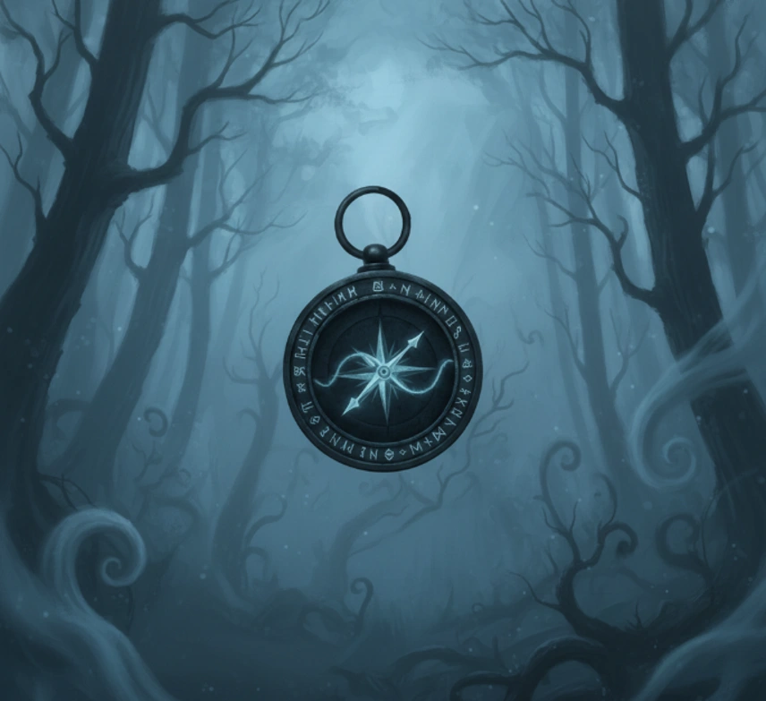

This small, ornate compass is forged of cold iron and inlaid with runes written in a language that shifts and reforms when viewed in the corner of your eye. It was crafted by a mage-explorer who sought to map the ever-shifting paths of the Shadowfell — but the darkness consumed them before their task was complete.

When held, the compass’ needle doesn’t point north, but instead spins slowly until it faces a direction that feels *safer* — or *less hostile* — than the one you are currently facing. Its casing is faintly cold to the touch, and the runes pulse dimly whenever the Weave is unstable nearby.

### Properties

**Shadowed Navigation.** While attuned to the Compass of the Forgotten Path, you gain a **+1d4 bonus on Wisdom (Survival) checks** made to avoid becoming lost or to navigate in the Shadowfell or other gloom-touched planes.

**Weave Stabilizer.** Whenever you cast a spell while in the Shadowfell and must make a **Spellcasting Ability check** due to unstable magic, you may roll **1d4** and add the result to the check.

**Resonant Focus.** The compass counts as an **arcane focus** for the purposes of spellcasting. When you use it as such, the shadows around you subtly twist.
